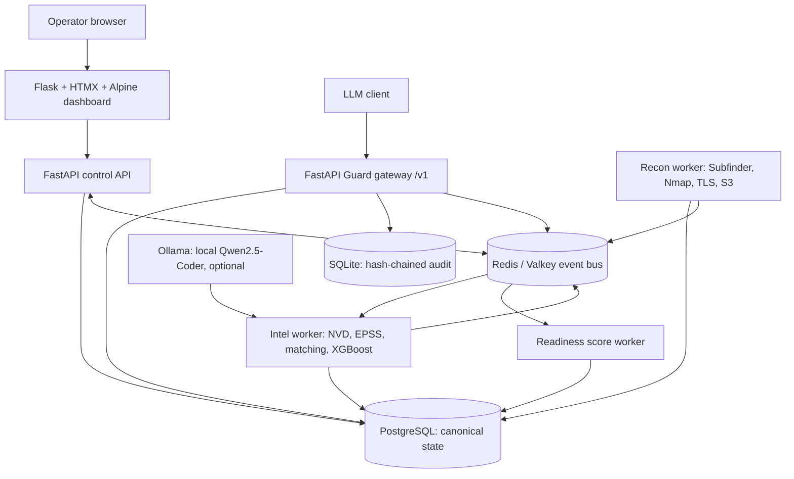
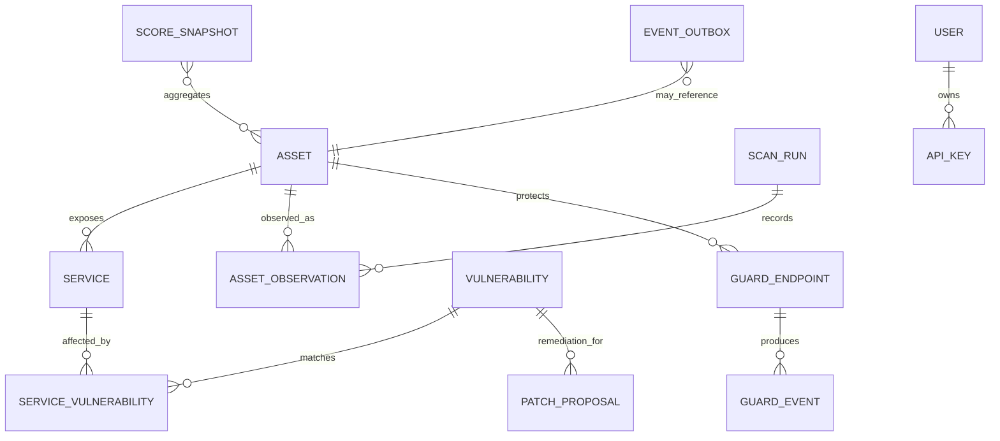

# ZeroTrace — Complete Project Documentation

> **Consolidated reference.** This single document contains the project overview, architecture, Recon, Intel, Guard, Operational Readiness score and tests, the revised one-week MVP plan, and both execution approaches. It incorporates the current wiki contents; the earlier 14-week schedule has been replaced by a seven-day prototype sprint.

## Contents

1. [Project overview and readiness](#zero-trace--compiled-project-wiki)
2. [Architecture](#zerotrace-architecture)
3. [Trace Recon](#trace-recon--attack-surface-discovery)
4. [Trace Intel](#trace-intel--vulnerability-prioritization)
5. [Trace Guard](#trace-guard--llm-security-middleware)
6. [Operational Readiness](#operational-readiness-score-and-validation)
7. [One-week MVP plan](#one-week-zerotrace-mvp-plan)
8. [Execution options](#execution-options-scratch-build-vs-reuse)

---
# ZeroTrace — compiled project wiki

> **Purpose:** CPU-optimized, open-source cyber defense for one laptop: Recon discovers assets, Intel prioritizes vulnerabilities, and Guard protects LLM traffic. PostgreSQL is the shared source of state; Redis/Valkey carries events; SQLite stores a local tamper-evident Guard audit chain.

**Compiled from:** `ZeroTrace—ProjectDocumentationv2.0.pdf` (version 2.0, August 2026), treated as the immutable source. This wiki is the maintained, navigable interpretation; when it differs from the source, record the discrepancy here and in the affected page rather than silently rewriting the source.

## Navigation

| Page | Scope | Readiness |
|---|---|---|
| [Architecture](#zerotrace-architecture) | Topology, ERD, events, hardware and deployment boundaries | Compiled; resource budget needs measurement |
| [Trace Recon](#trace-recon--attack-surface-discovery) | Discovery, scans, shadow IT, errors | Compiled; implementation and authorization controls pending |
| [Trace Intel](#trace-intel--vulnerability-prioritization) | NVD/EPSS, asset-CVE matching, model, patch queue, assisted fixes | Compiled; training data/model validation pending |
| [Trace Guard](#trace-guard--llm-security-middleware) | OpenAI-compatible gateway, injection controls, PII and audit | Compiled; classifier, policy, and fail-open decisions need validation |
| [Operational Readiness](#operational-readiness-score-and-validation) | Score formula, interpretation, evaluation matrix | Compiled; source arithmetic has unresolved inconsistency |
| [Development Plan](#one-week-zerotrace-mvp-plan) | One-week MVP sprint and daily exit gates | Compiled; proposed schedule, not evidence of completion |
| [Execution Options](#execution-options-scratch-build-vs-reuse) | Scratch architecture and battle-tested reuse/merge strategy | Researched; licensing and integration tests remain gates |

## System at a glance

- **Recon:** passive subdomain enumeration (Subfinder/certificate streams), Nmap top-100 service discovery, S3 configuration checks, TLS certificate expiry monitoring, and inventory-difference/Shadow IT flags.
- **Intel:** incremental NVD CVE and daily FIRST EPSS ingestion; CPE/service-version correlation; XGBoost-based exploit likelihood prioritization; a rolling 48-hour urgency focus; generated remediation proposals with mandatory review and isolated validation.
- **Guard:** FastAPI `/v1/chat/completions` reverse proxy; cheap regex/heuristic prefilter; CPU ONNX DistilBERT semantic detector; response PII scanner; per-client token-bucket rate limiting; SQLite SHA-256 chained audit records.
- **Integration:** durable relational state in PostgreSQL; Redis-compatible event bus (Valkey is a drop-in project choice); deterministic readiness score recomputation on `asset_created`, `vuln_matched`, `attack_blocked`, and `vuln_patched`.
- **Deployment target:** Docker Compose, CPU-only, 16 GB RAM minimum in the source; user-stated goal is approximately 9 GB total on a 16 GB laptop. Treat this as a benchmark target, not a proven footprint.

## Readiness snapshot

| Area | State | Evidence / next gate |
|---|---|---|
| Source ingestion | Complete | Full 26-page PDF extracted once during initial setup |
| Wiki compilation | Complete | Requested pages plus execution-options page linked above |
| Architecture decision | Drafted | Validate exact service boundaries, event delivery guarantees, and memory on target laptop |
| Recon / Intel / Guard code | Not started | Follow phased implementation and tests |
| Evaluation | Not run | Use the matrix in [Operational Readiness](#operational-readiness-score-and-validation) |
| Production hardening | Not ready | Threat model, review gates, auth, secrets, backups, scan authorization, and fail modes must be implemented and tested |

## Source interpretation and known discrepancies

1. The PDF’s memory map names 20 GB as the tested/comfortable baseline and lists OS/WSL, Ollama, and services separately. It does not substantiate a measured 9 GB *whole laptop* footprint on 16 GB. Measure peak resident memory with the selected model loaded and scanning; optimize or provide a reduced profile if needed.
2. The stated score formula gives `100 − (0.40×AEI + 0.40×VUI + 0.20×AIET)`. The validation row for combined indexes `20, 35, 25` yields **73**, not the printed 71. The end-to-end sequence also includes values inconsistent with the shown formula. See [Operational Readiness](#operational-readiness-score-and-validation); preserve the equation as the governing definition until product owners correct the scenario fixture.
3. The 48-hour patch queue is an operational ranking window, not the EPSS forecast horizon. FIRST describes EPSS as a probability of exploitation in the next 30 days. Keep those semantics distinct.
4. User brief says “S3”; the source calls for S3 misconfiguration checks but does not define API provider or credential model. Default to passive/public checks and explicit opt-in for authenticated account checks.
5. “Auto-fix” is assistance, not autonomous production change: source explicitly calls for syntax validation, sandboxing, and human review. Never execute generated scripts against a real target by default.

## Operating contract

1. Read this `index.md` first on later sessions; then open only the relevant page(s), never the immutable PDF or a raw dump unless explicitly instructed to audit a source claim.
2. Keep each concern in its owning page and link across pages rather than duplicating detailed specifications.
3. Label facts from the source versus implementation decisions and unresolved assumptions.
4. Update readiness states only when an implementation artifact or test evidence exists.
5. External scanning must be limited to assets the operator is authorized to assess; set timeouts, rate limits, concurrency bounds, and an allowlist.

---

# ZeroTrace architecture

[← Wiki index](#zero-trace--compiled-project-wiki) · Related: [Recon](#trace-recon--attack-surface-discovery) · [Intel](#trace-intel--vulnerability-prioritization) · [Guard](#trace-guard--llm-security-middleware) · [Readiness](#operational-readiness-score-and-validation)

## Topology



The source describes three modules sharing PostgreSQL and Redis Pub/Sub. This design makes the API/UI, scanner workers, and Guard independently restartable while keeping a single laptop Compose project. PostgreSQL is authoritative; Redis is a fast notification path, not the only copy of critical facts. Consumers should be idempotent and periodically reconcile from database state. For reliable processing, use Redis Streams or a PostgreSQL outbox rather than assuming Pub/Sub is durable.

## Service boundaries

| Service | Responsibilities | Exposed ports |
|---|---|---|
| `dashboard` | Flask-Login session UI; calls control API | Host-facing HTTPS only |
| `api` | FastAPI REST, auth/RBAC, scans/patch queue/readiness | Host-facing HTTPS or dashboard internal only |
| `recon-worker` | Bounded scanner processes and normalized findings | None |
| `intel-worker` | Feed sync, CPE match, score, remediation proposal lifecycle | None |
| `guard` | OpenAI-compatible reverse proxy, detection, PII scan, API-key auth | Host-facing HTTPS if clients need it |
| `postgres` | Canonical relational state | Internal Compose network only |
| `valkey` | Cache, rate limiting, event notifications | Internal only |
| `ollama` | Optional local model inference; only accessed by Intel | Internal only |

The PDF proposes FastAPI plus Flask dashboard. Keep Flask limited to HTML/session UI and FastAPI as the API/proxy boundary to avoid duplicated business logic. Run schema migrations once as a one-shot Compose job; workers must wait for healthy dependencies and handle reconnects.

## Relational model (logical ERD)



### Core entities

- **Asset:** stable identity (normalized hostname/IP/cloud resource), first/last seen, owner/environment tags, source, authorization scope, status. Unique key should be tenant/scope + canonical identifier, not merely raw string.
- **Service:** asset FK, protocol, port, product/version/banner, CPE (nullable), exposure status, last checked.
- **AssetObservation / ScanRun:** timestamped scanner provenance, raw-result reference, status and error; retain scan history to distinguish newly found, stale, and Shadow IT assets.
- **Vulnerability:** CVE identifier, NVD facts/CVSS, EPSS value/date, KEV status, model version/probability and source timestamps.
- **ServiceVulnerability:** service FK + vulnerability FK, match confidence/method, evidence, review status. Avoid claiming a match from product-name similarity alone.
- **PatchProposal:** target, generated content/hash, model/prompt version, validation results, approval/execution state, reviewer, rollback note. Default state is `proposed`, never auto-applied.
- **GuardEndpoint / GuardEvent:** endpoint mapping and per-request metadata: outcome, scores, policy/model versions, latency, endpoint and linked asset/vulnerability IDs where known. Do not store plaintext prompt/response by default.
- **ScoreSnapshot:** component indexes, weights, final score, computation time and formula version for reproducibility.
- **EventOutbox:** transactional events written with the state change then published/retried; consumers store processed event IDs for idempotence.
- **User / APIKey:** role, salted password hash or key hash, rotation/expiry, audit metadata. Never persist raw API keys.

## Event flows

| Event | Producer → consumer | Expected action |
|---|---|---|
| `asset_created` | Recon → Intel / score engine | Correlate services to CVEs, update exposure index, recompute score |
| `vuln_matched` | Intel → Guard / score engine | Attach CVE context to matching Guard endpoint and elevate event priority |
| `attack_blocked` | Guard → score engine | Update AI exposure and recompute score |
| `vuln_patched` | Intel → Recon / score engine | Schedule a verification rescan, update status and recalculate |

Persist source state before publishing. Include event ID, schema version, entity ID, timestamp, correlation ID and bounded payload; publish identifiers rather than secrets or raw prompts. Use retries with backoff and a dead-letter table/stream. Rebuild derived scores from canonical records.

## Resource fit and profiles

The PDF claims roughly 9 GB active footprint, minimum 16 GB RAM, and separately lists Windows (~4 GB), WSL2 (~2 GB), Postgres (~0.5 GB), Valkey (~0.3 GB), FastAPI (~0.6 GB), Ollama Q4 7B (~4.5 GB), ONNX (~0.4 GB), and Flask (~0.2 GB). These line items do not establish a reproducible 9 GB peak including host OS, Docker overhead, scanner concurrency, and model loading. The design goal supplied by the user is **about 9 GB on a 16 GB laptop**; treat it as a performance acceptance criterion.

Use resource limits and concurrency controls. Offer profiles: `core` (no Ollama; regex + quantized/light CPU classifier), `full` (all models, low scanner concurrency), and `dev`. Measure cold start and peak RSS under concurrent Recon + Guard + model inference, leaving at least 2–3 GB host headroom. Set model context and worker counts explicitly. If Qwen2.5-Coder 7B does not fit, make auto-fix an opt-in resource-heavy capability rather than breaking the core platform.

## Deployment and security boundaries

- Compose networks: internal data network and ingress network. Do not publish PostgreSQL or Valkey ports to the host by default.
- Mount secrets through env files/secrets; `.env` is untracked and permission-restricted. Use bcrypt password hashes, short-lived JWTs, roles, CSRF defense, and API key hashes.
- Use TLS at the ingress boundary; set security headers. The source lists self-signed TLS and strict security headers for local use.
- Persistent named volumes for PostgreSQL and audit data; scheduled `pg_dump` backups and tested restore. SQLite audit chain is tamper-evident, not immune to privileged deletion; copy checkpoints off the writable container volume when stronger evidence preservation is required.
- Restrict scanners to configured domains/CIDRs and explicit authorization. Avoid privileged Nmap modes unless specifically needed; document capabilities and scan types.

## Open decisions

1. Choose Redis Pub/Sub simplicity versus Streams/Postgres outbox reliability.
2. Define tenant/scope identity and asset ownership model before schema migration v1.
3. Set exact Guard fail-open policy (source says Redis limiter outage fails open; consider fail-closed or bounded local limiter for protected production endpoints).
4. Define the 9 GB measurement method and minimum supported profile.
5. Clarify whether host API docs are enabled outside development.

---

# Trace Recon — attack surface discovery

[← Wiki index](#zero-trace--compiled-project-wiki) · Related: [Architecture](#zerotrace-architecture) · [Intel](#trace-intel--vulnerability-prioritization) · [Development plan](#one-week-zerotrace-mvp-plan)

## Mission

Find authorized assets and exposed services, retain evidence and provenance, flag inventory drift (potential Shadow IT), and hand normalized records to Intel. Recon is a discovery system, not an exploit tool. Its output must be limited to explicitly scoped targets.

## Inputs and outputs

**Inputs:** authorized root domain/CIDR or account scope; known inventory; scan profile; concurrency/rate/time limits; optional provider credentials for source APIs.

**Outputs:** canonical assets, services, SSL status, S3 findings, scan run and provenance, inventory delta, structured warnings and partial-result status. Emit `asset_created` only after the transaction commits. Repeated scans upsert stable identities and append observations instead of duplicating assets.

## Pipeline

1. **Scope validation:** normalize and check target against an allowlist and proof/approval record. Reject wildcard or out-of-scope targets. Do not launch on a raw user-supplied hostname without scope validation.
2. **Passive discovery:** query certificate transparency feeds and Subfinder. Preserve source names, timestamps and confidence. Subfinder's passive mode discovers subdomains from online sources; some providers require API keys. DNS-resolve candidates and mark unresolved entries rather than silently treating them as live.
3. **Service scan:** run Nmap on authorized resolved targets, default to top 100 TCP ports as specified by the source. Use controlled flags, bounded concurrency, per-target timeouts and structured XML output. Scan findings are observations, not proof that a service is vulnerable.
4. **S3 checks:** check bucket naming/access/configuration only through approved public checks or explicitly authorized cloud credentials. Distinguish public-readable, public-listable, denied, unknown, and transient error. Never upload/delete objects or attempt access beyond the permission test.
5. **TLS checks:** connect with a timeout, record certificate subject/SAN, issuer, validity window, chain/handshake error, and check time. Separate “expired”, “expires soon”, “unreachable”, and “unknown”.
6. **Shadow IT delta:** compare normalized discoveries with a reviewed inventory/owner mapping. Flag new/unowned/stale assets as “unmanaged candidate”; do not assert maliciousness solely from absence in inventory.
7. **Persist + publish:** transactionally upsert assets/services and observations, then publish durable `asset_created`/updated events via the outbox. Intel consumes changes for matching.

## Data and API contract

Suggested API: `POST /api/recon/scans` creates a job (202 + `scan_id`); `GET /api/recon/scans/{scan_id}` returns state and progress; `GET /api/assets` and `GET /api/assets/{id}` return normalized inventory with last-seen and provenance. Operator role may scan only approved scopes; viewer is read-only. Idempotency key prevents duplicate jobs on retries.

Record `scan_id`, `scope_id`, tool/version, exact safe profile, start/end, exit code, parse status, target count, result count, warnings and a protected reference to raw output. Do not store scanner secrets in result payloads.

## Error handling (source requirements)

| Failure | Detection | Recovery |
|---|---|---|
| Subfinder timeout | Exceeds 120 s in source target | Terminate process, retain partial results, warn; make timeout configurable per profile |
| Nmap returns zero open ports | No open findings | Mark “no ports observed / may be filtered”; do not claim host is safe |
| S3 API HTTP 429 | Rate limit | Exponential retry; source says 3 attempts at 30/60/120 s (this represents three waits/retries; implement bounded policy and honor Retry-After) |
| SSL connection refused | Handshake/connect failure | Mark unreachable; continue other checks |
| DNS NXDOMAIN | Resolver response | Return target error; do not queue dependent active scans |
| Scanner process failure | Non-zero exit or malformed output | Mark partial/failed with stderr excerpt sanitized; never parse failure as an empty successful scan |

## Operational controls

Default safe rates; global worker semaphore; per-scope caps; hard timeout; cancel endpoint; process-group termination; output size limit; no shell interpolation (argument arrays); container filesystem read-only where possible. Nmap raw packet scanning may require privileges; prefer unprivileged connect scans, avoid host networking/capabilities unless documented and needed. Re-run variability only as an evaluation mode; production does not need three full scans for each target.

## Evaluation targets from the source

- Subdomain recall ≥90% and precision ≥95% against declared-scope domains.
- Nmap parity with standalone on the same controlled lab, not internet targets.
- S3 false positives ≤5%; false negatives ≤10% on 25 known-public + 25 known-private fixtures.
- SSL expiry accuracy 100% against 50 known certificates.
- Detect all 10 intentionally planted inventory-only assets.
- Full run on 50 subdomains ≤10 minutes.

Track sample size, ground-truth date, source coverage, tool version, allowed scan profile and confidence intervals; these source targets are acceptance goals, not measured results.

---

# Trace Intel — vulnerability prioritization

[← Wiki index](#zero-trace--compiled-project-wiki) · Related: [Architecture](#zerotrace-architecture) · [Recon](#trace-recon--attack-surface-discovery) · [Guard](#trace-guard--llm-security-middleware) · [Readiness](#operational-readiness-score-and-validation)

## Mission and inputs

Intel correlates Recon's observed services to vulnerability records, ranks remediation urgency, and proposes fixes. Inputs are asset/service observations (product, version, CPE if available), NVD CVE records, FIRST EPSS daily scores, CISA KEV membership, and optional social/exploitation signals. Every score must carry source timestamps and model version. EPSS is a probability of exploitation in the next **30 days**; ZeroTrace's **48-hour queue** is a workflow window for urgent triage, not the EPSS prediction horizon.

## Ingestion and normalization

- **NVD:** use the CVE 2.0 REST API with pagination and incremental modified-date windows; store raw source timestamp and normalized CVE/CPE/CVSS data. Respect rate limits, cache successful responses, use backoff, and checkpoint each page. A failed sync never replaces a good snapshot with empty data.
- **EPSS:** ingest daily CSV or API scores keyed by CVE, with score date, score and percentile. Preserve historic values for reproducibility.
- **KEV:** periodically ingest CISA Known Exploited Vulnerabilities catalog; expose it as an explicit categorical signal and queue boost.
- **Data quality:** validate identifiers, ranges, duplicate keys, schema versions and stale timestamps; quarantine malformed rows and report coverage.

## Asset-to-CVE matching

1. Normalize service banner/product/version and map to CPE using explicit deterministic aliases and version rules.
2. Match CPE ranges against NVD affected configurations; attach evidence, match method, and confidence.
3. Unknown/ambiguous versions stay `possible_match` and require review; never present fuzzy matching as confirmed.
4. Keep the original observation so improvements to mapping can be re-run.
5. Link a matched service to Guard endpoint metadata when an operator has configured the relationship; this adds context but must not imply network reachability or exploitability.

## Prioritization model

The PDF specifies an XGBoost exploit-probability model using CVSS, EPSS and social signals. Implement a transparent baseline before a learned model: feature pipeline with a documented version, probability calibration, missing-value behavior and validation split by time/CVE to avoid leakage. EPSS is already a predictive ML signal; test whether XGBoost adds value over EPSS and KEV rather than assuming it does. Train only on outcomes available as-of the evaluation timestamp, compare top-k yield and calibration against CVSS, EPSS, and KEV-only heuristics. Store model artifact checksum and training data window. If the model is absent, source says scoring endpoint returns 503; the queue can still show deterministic EPSS/CVSS/KEV fallback clearly marked as non-ML if product owner chooses that behavior.

Suggested queue ordering: known KEV first; then calibrated predicted exploitation × business/asset criticality and exposure, with CVSS impact as a separate factor. Do not equate CVSS severity with probability. Display why an item ranks where it does and source data age. Define “48-hour focus” as items due for analyst action in the next 48 hours, with explicit time zone and SLA.

## Auto-fix proposal lifecycle

Qwen2.5-Coder 7B Q4 via local Ollama is a proposal generator, not an authority. Prompt with bounded CVE and environment facts; do not include secrets. Generate Bash/Ansible/Terraform only as applicable, attach provenance and a SHA-256 digest, and mark `proposed`. Apply strict output schema and allowlisted operations; reject destructive/privilege-escalating commands unless explicitly reviewed. Run static validation (`bash -n`, Ansible syntax checks, format/lint), then test in an isolated disposable Docker fixture with no production credentials/network. Require an operator to review impact, backup/rollback and approve. Execute manually or through a separately constrained job; re-scan to verify via Recon. On 60s Ollama timeout, source allows a clearly marked incomplete draft; safer default is no executable artifact and a manual-remediation note. Invalid syntax is rejected, not merely warned.

## Errors and fallback

| Failure | Behavior |
|---|---|
| NVD 403/429/downtime | Keep last good cache, retry with bounded backoff (source: retry after an hour), surface data freshness |
| EPSS download failure | Use last valid file and mark stale/estimated; never hide age |
| XGBoost artifact missing | Report model unavailable; keep deterministic non-ML data only if explicitly enabled |
| Ollama timeout | No silent success; return incomplete/manual-review state, with no automatic execution |
| Invalid generated syntax | Reject proposal; record validation failure |
| CPE ambiguous | Candidate match with confidence and review queue |

## Evaluation targets from source

- On 200 CVEs with known outcomes, XGBoost top-20 contains at least 15 exploited; should not underperform EPSS top-20 (source target).
- CPE matching ≥90% on 100 known services.
- NVD 48-hour ingestion completeness ≥99% versus API results.
- 30 isolated test CVEs: ≥70% scripts syntactically run; ≥95% safe on unrelated-service regression review.
- Top-20 overlap with CISA KEV ≥60%.

Treat these as targets, not demonstrated results. Define label windows, train/test split, denominators and uncertainty before judging model quality. Never optimize a metric by selecting only easy CVEs.

---

# Trace Guard — LLM security middleware

[← Wiki index](#zero-trace--compiled-project-wiki) · Related: [Architecture](#zerotrace-architecture) · [Intel](#trace-intel--vulnerability-prioritization) · [Operational Readiness](#operational-readiness-score-and-validation)

## Contract

FastAPI reverse proxy exposing an OpenAI-compatible `/v1/chat/completions` interface. Authenticated LLM clients send requests through Guard; Guard applies rate limits, fast regex/heuristic rules, an ONNX DistilBERT semantic classifier, forwards accepted traffic to a configured upstream (including local Ollama), scans output for possible PII, then returns a compatible response and records minimal audit metadata.

Support non-streaming first. Streaming requires incremental policy decisions and response PII scanning; do not claim full output protection until the stream can be buffered or scanned safely. Preserve status/error semantics, timeouts, cancellation and request IDs. Restrict upstream hosts to configured allowlists to prevent SSRF.

## Request pipeline

1. Enforce request body size, JSON schema, client API key and per-client token bucket.
2. Normalize prompt text while retaining message boundaries and modality metadata; do not flatten untrusted context into privileged instructions.
3. Apply fast regex and heuristic rules. Hard-block only high-confidence policies; record rule/version.
4. Run ONNX DistilBERT classifier under a strict CPU time budget. Use validated local tokenizer/model files and calibration threshold. Score is a signal, not proof; threshold decisions are measured against false positive/negative costs.
5. On allowed requests, proxy upstream with a bounded timeout and request correlation ID.
6. Scan response text for possible PII (SSN, emails, card numbers, API-key patterns). Redact only according to explicit policy; distinguish `potential PII` from confirmed matches and preserve the original response only if an approved, access-controlled retention policy requires it.
7. Append event to SQLite audit chain; return response and Guard headers/metadata. Record block reason and classifier/rule versions without persisting prompt/response plaintext by default.
8. Publish `attack_blocked` and linked endpoint context to event bus; Intel CVE association can elevate priority.

## Components and interfaces

- FastAPI route compatible with `/v1/chat/completions`; include `/health`, `/ready`, and internal diagnostics with no sensitive data.
- Detector interface: `classify(messages) -> {score, label, model_version, latency_ms}`; deterministic regex detector is usable if model unavailable, with health state `DEGRADED`.
- PII scanner returns typed candidate spans and confidence; tests cover false positives and redaction boundaries.
- Rate limiting via Valkey token bucket keyed by hashed client identity. Never use raw API keys as Redis keys or logs.
- SQLite append-only logical table fields: sequence, UTC timestamp, event type, client pseudonym, endpoint ID, outcome, scores, rule/model versions, previous hash, row hash. Hash canonicalized serialized event + previous hash using SHA-256. Add periodic signed/exported checkpoints if stronger tamper evidence is needed.

## Audit integrity and privacy

A hash chain detects interior modification/deletion when a trusted prior/final checkpoint exists; it does **not** prevent an administrator from deleting the whole file or rewriting all rows. Keep filesystem permissions restrictive, use append-only transactions, run `verify_audit_integrity()` on startup and scheduled checks, and export checkpoints to a separate protected location. Minimize data: prompt hash or keyed HMAC, lengths, detector outcomes and endpoint identifiers are preferred to raw prompt text. Hashes of low-entropy prompts can be guessable; use HMAC with a secret if correlation is needed. Document retention and access.

## Source error behavior and policy decisions

| Failure | Source behavior | Recommended implementation note |
|---|---|---|
| ONNX missing/version mismatch | Regex-only; critical warning; dashboard DEGRADED | Make semantic bypass visible and configurable; do not represent as full protection |
| Inference >200 ms | Skip semantic check and forward with unverified flag | For high-risk deployment, consider fail-closed or queue/deny; source specifies fail-open forwarding |
| Upstream unreachable | 502, log error, no cache | Return OpenAI-compatible error envelope and correlation ID |
| PII likely false positive | Log `potential PII`, require manual review | Avoid destructive redaction without policy; don’t log the sensitive span |
| Redis rate limiter unavailable | Source says fail-open and critical alert | Security-critical tradeoff; use local bounded limiter or fail closed by policy, and test outage behavior |
| SQLite append failure | Not specified | Recommended: fail closed for protected requests if audit is mandatory, or explicit degraded mode and alert; never silently discard audit |

## Security boundaries

Guard has dedicated API-key auth; keys stored as hashes, rotated and scoped. Use request/response size limits, concurrency caps, per-client quotas, upstream TLS verification, SSRF allowlists, DNS rebinding precautions, timeouts, and safe exception handling. Never pass secrets through classifier prompts or logs. A blocked prompt is not necessarily a verified attack; mark classifier confidence and outcome separately.

## Evaluation targets from source

- Regex catches ≥60% of 500 JailbreakBench prompts.
- Semantic classifier catches ≥85%; full pipeline ≥92% on that set.
- ≤5% false positives on 500 legitimate ShareGPT prompts.
- PII recall ≥90% on 100 responses containing seeded SSN/API key/email/card patterns; false-positive redaction ≤10% on 100 clean responses.
- Guard adds ≤50 ms to a nominal 500 ms direct response; regex ≤5 ms; ONNX ≤20 ms per prompt.
- Of 100 requests in 10 seconds from one client, ≤10 processed under configured limiter.

Record dataset versions, prompt policy, model checksum, threshold, CPU/hardware and whether the evaluation uses the same distributions as tuning. Separate detection recall from actual harmful-output prevention; benchmark values are targets, not evidence of production security.

---

# Operational Readiness Score and validation

[← Wiki index](#zero-trace--compiled-project-wiki) · Related: [Architecture](#zerotrace-architecture) · [Intel](#trace-intel--vulnerability-prioritization) · [Guard](#trace-guard--llm-security-middleware)

## Governing equation

The v2.0 source defines three **negative exposure indexes**, each on a 0–100 scale:

```text
Score = clamp(100 - (0.40 × AEI + 0.40 × VUI + 0.20 × AIET), 0, 100)
```

- `AEI` — Asset Exposure Index = exposed services / total services × 100.
- `VUI` — Vulnerability Urgency Index = Σ(ML exploit probability × CVSS severity) / total assets × 100.
- `AIET` — AI Threat Exposure Index = unblocked attack attempts / total LLM requests × 100.

Clamp prevents out-of-range values. Define zero-denominator behavior explicitly: if no services or no LLM requests exist, report the component as `unknown` (and show coverage) rather than quietly assuming 0 risk. Normalize CVSS to 0–1 before multiplying by probability, or specify the exact scale; the source formula as written does not fully specify the units/scaling of VUI. Recommended: publish a formula version and keep component values, denominators and missingness alongside each snapshot.

The source corrected “AI Threat Block Rate” to “AI Threat Exposure Index” because better blocking should improve, not reduce, readiness. All inputs are adverse factors, so higher adverse indexes lower the score.

## Important source arithmetic inconsistency

For indexes `(20, 35, 25)`, the displayed equation gives `100 − (8 + 14 + 5) = 73`; the source table prints 71. The printed one-critical-CVE row `(0,35,0)` yields 86 and is consistent; the one-exposed-service row `(20,0,0)` yields 92; the unblocked-attack row `(0,0,25)` yields 95. The full-cycle sequence has further values not derivable from the supplied formula. The implementation should treat the equation as authoritative and correct fixture expectations to 73 unless the product owner formally revises the formula. The score is not an empirically calibrated probability.

## Interpretation bands (source)

| Score | Status | Operational meaning |
|---|---|---|
| 90–100 | Secure | Maintain posture; inspect component coverage |
| 70–89 | Moderate | Review queue and exposed services |
| 50–69 | Elevated | Prompt remediation and investigate active AI events |
| 0–49 | Critical | Incident response; isolate/patch as appropriate |

Bands communicate posture, not a guarantee of safety. Show the three component indexes, last-updated time, denominator/coverage and open critical findings alongside the headline score.

## Unit and property tests

| Scenario | AEI | VUI | AIET | Expected using equation | Validates |
|---|---:|---:|---:|---:|---|
| Fully secure baseline | 0 | 0 | 0 | 100 | Maximum score |
| One exposed MySQL port | 20 | 0 | 0 | 92 | Asset term |
| One critical CVE | 0 | 35 | 0 | 86 | Vulnerability term |
| One unblocked jailbreak | 0 | 0 | 25 | 95 | AI exposure term |
| All three combined | 20 | 35 | 25 | **73** | Weighted compound (source says 71; corrected by arithmetic) |
| After CVE is patched | 20 | 0 | 25 | 87 | Remediation recovery |
| After close port + patch | 0 | 0 | 25 | 95 | Recovery |

Properties: deterministic for identical versioned inputs; monotone non-increasing when any adverse component rises and others stay fixed; monotone recovery when a component improves; output bounded in `[0,100]`; scores reproducible from stored snapshot and formula version. Test rounding only at presentation layer.

## Evaluation test matrix

| Layer | Test | Pass target from source |
|---|---|---|
| Recon | Subdomain recall / precision | ≥90% / ≥95% |
| Recon | Nmap parity / S3 FP / FN / TLS expiry | 100% parity / ≤5% / ≤10% / 100% |
| Recon | 10 planted Shadow IT items / 50-subdomain scan duration | 10/10 / ≤10 min |
| Intel | XGBoost vs CVSS top-20 on 200 known-outcome CVEs | ≥15 exploited in top 20; compare to EPSS top-20 |
| Intel | CPE match / 48-hour NVD completeness | ≥90% / ≥99% |
| Intel | 30 auto-fix scripts success / safety | ≥70% syntactic test success / ≥95% safe |
| Intel | Top-20 patch queue vs KEV | ≥60% overlap |
| Guard | JailbreakBench regex / ONNX / combined catch | ≥60% / ≥85% / ≥92% |
| Guard | ShareGPT false positive rate | ≤5% |
| Guard | Seeded PII recall / clean PII false positives | ≥90% / ≤10% |
| Guard | End-to-end overhead; regex; ONNX | ≤50 ms; ≤5 ms; ≤20 ms |
| Guard | 100 requests / 10 seconds from one client | ≤10 processed |
| Score | Monotonicity, recovery, sensitivity, determinism | Decreases with adverse events, rises on remediation, proportional, zero variance |
| Integration | Recon→Intel; Intel→Guard; Guard→score; full cycle | CVE matched within 60 s; endpoint priority elevated; score responds; verify using equation and corrected fixtures |

The PDF specifies a 20 GB Dell/WSL2 test setup in its evaluation section while calling 16 GB the minimum elsewhere. Run a minimum-spec 16 GB profile in addition to source hardware; report RAM use, CPU model, model profile, tool versions, sample size and test seed.

---

# One-week ZeroTrace MVP plan

[← Wiki index](#zero-trace--compiled-project-wiki) · Related: [Architecture](#zerotrace-architecture) · [Readiness](#operational-readiness-score-and-validation) · [Execution Options](#execution-options-scratch-build-vs-reuse)

This is a **one-week prototype/MVP sprint**, replacing the source PDF’s 14-week schedule. It prioritizes one thin, end-to-end vertical slice with reusable upstream tools. It does **not** imply full production readiness or achievement of every large-scale evaluation target in one week. Assume one experienced developer, a prepared Docker-capable laptop, and work on a controlled authorized lab only.

## Seven-day schedule

| Day | Focus | Deliverable | Exit gate |
|---|---|---|---|
| 1 | Foundation | Compose skeleton; FastAPI `/health`; PostgreSQL + migrations; minimal dashboard shell; configuration and secret handling | Clean start; health checks pass; DB/Valkey not published to host |
| 2 | Recon vertical slice | Scope allowlist; Subfinder + Nmap adapters; persist assets/services/scan status | Scan only an authorized lab target; result and errors appear in API/dashboard |
| 3 | Intel vertical slice | NVD/EPSS snapshot ingestion; basic CPE/service matching; transparent ranking baseline and patch queue | Fixture CVE matches a fixture service; stale-feed/error state visible |
| 4 | Guard vertical slice | Non-streaming OpenAI-compatible FastAPI proxy; regex rules; upstream forwarding; minimal PII pattern scanner | Known malicious fixture blocked; normal fixture passes; upstream outage returns controlled 502 |
| 5 | Integration + score | Redis/Valkey event flow or outbox; score calculation; Intel context linked to Guard endpoint | Asset, CVE and Guard-event changes produce deterministic, equation-correct score updates |
| 6 | Hardening + tests | Auth/RBAC basics; rate/timeout limits; audit chain; dependency and Compose checks; focused tests | Restart, malformed input, missing model/feed, Redis outage and audit verification tested; no known critical blocker |
| 7 | Demo + handoff | One-command setup, README, API examples, short demo, limitations and next backlog | Fresh-clone smoke test passes; evaluation results and known gaps recorded |

## One-week scope limits

To protect delivery quality, the first-week outcome should be a **working, auditable prototype**, not the entire v2.0 vision. Defer full XGBoost training, comprehensive S3 account checks, exhaustive scanner benchmarks, ONNX classifier calibration against full datasets, Ollama-generated remediation execution, production streaming Guard, multi-user/tenant features, and claims of 9 GB peak RAM until dedicated follow-up validation. Use a simple, explainable priority baseline (KEV/EPSS/CVSS) before introducing a trained model. Keep auto-fix as a non-executable draft or defer it entirely.

The end-of-week demo should use synthetic fixtures or an explicitly authorized lab. Do not run broad Internet scans to meet a deadline. The [execution options](#execution-options-scratch-build-vs-reuse) page recommends using mature tools behind small ZeroTrace adapters to make this compressed scope feasible.

## Daily working gates

### Day 1 — foundation

Create Compose services and internal networks; define environment settings, health/readiness checks, migration path, and first core tables. Keep secrets out of source control. Confirm the selected profile starts within memory limits before adding local models.

### Day 2 — Recon

Implement scope validation before invoking scanners. Use bounded Subfinder and Nmap commands with structured output parsing and timeouts. Store provenance and partial failures. Do not expose arbitrary command arguments through the API.

### Day 3 — Intel

Ingest a small, reproducible NVD/EPSS sample or bounded current snapshot; checkpoint feed freshness. Implement CPE matching only for known fixtures and show ambiguity instead of false certainty. Order the patch queue with a documented baseline.

### Day 4 — Guard

Deliver non-streaming `/v1/chat/completions` compatibility first. Add client auth, request-size/time limits, a small regex policy, upstream allowlist, and a basic PII signal. Treat missing semantic-model support as visibly degraded; no silent bypass.

### Day 5 — integration

Persist state before emitting events. Use idempotent handlers and recompute the score from canonical data. Follow the exact equation and corrected test fixture in [Operational Readiness](#operational-readiness-score-and-validation); the combined sample is 73, not the source PDF’s 71.

### Day 6 — safety and checks

Test dependency restart, unavailable NVD/EPSS, slow/missing classifier, Redis outage, malformed scanner output, upstream timeout, and audit-chain tampering. Make any fail-open behavior conspicuous. Test backup/restore if there is time; document untested areas.

### Day 7 — handoff

Run from a clean clone, capture CPU/RAM and test results, document setup, API routes, model/tool versions, security boundaries, limitations and the next development backlog. Mark only evidence-backed readiness states as complete.

## Cross-cutting gates

- **Authorization:** all active Recon scans must be scope-allowlisted and approved.
- **Security:** no data-store host ports; secrets protected; authentication on control endpoints; upstream LLM destinations allowlisted.
- **Reliability:** partial/error states are explicit; no false “empty success” when a tool fails.
- **Readiness:** deterministic, bounded score; zero-denominator and missing-data behavior specified.
- **Honesty:** one-week MVP status is not equivalent to validated production security, classifier efficacy, full module coverage, or the PDF’s 14-week evaluation targets.

---

# Execution options: scratch build vs. reuse

[← Wiki index](#zero-trace--compiled-project-wiki) · Related: [Architecture](#zerotrace-architecture) · [Development plan](#one-week-zerotrace-mvp-plan)

## Approach A — scratch build, minimal paper architecture

Build the orchestration and domain model yourself, but delegate scanning and model inference to mature libraries/binaries. Keep each module a thin adapter and avoid building a generic SIEM, custom ORM, or frontend bundle.

### Suggested repository layout

```text
zerotrace/
├── compose.yaml
├── .env.example
├── pyproject.toml
├── README.md
├── app/
│   ├── api/                 # FastAPI routes, schemas, auth dependencies
│   ├── dashboard/           # Flask UI, HTMX templates, Alpine sprinkles
│   ├── domain/              # Asset, CVE, policy and readiness rules
│   ├── db/                  # SQLAlchemy models, Alembic migrations, session
│   ├── events/              # outbox, publisher, idempotent subscribers
│   ├── recon/               # scope, subfinder/nmap/S3/TLS adapters
│   ├── intel/               # feeds, CPE matcher, ranking, proposal validation
│   ├── guard/               # proxy, regex, ONNX, PII, rate limiter, audit
│   └── settings.py
├── templates/               # Jinja2 + HTMX
├── static/                  # minimal CSS, Alpine.js
├── migrations/
├── models/                   # checksummed ONNX/model metadata, not huge weights in git
├── scripts/                  # model download, admin bootstrap, backup/restore
├── tests/                    # unit, integration, controlled fixtures
└── docs/
```

### Lightweight implementation plan

- **FastAPI** for typed control API, OpenAPI docs, async upstream proxy and Guard interface.
- **Flask + HTMX + Alpine.js** only for server-rendered dashboard; Flask-Login session and CSRF. Share domain/service layer and SQLAlchemy models; do not call internal HTTP endpoints for every template action unless separate process boundary is intentional.
- **PostgreSQL + SQLAlchemy 2 + Alembic** as durable canonical state; bind internally. **Valkey** for event notifications, cache and token buckets. Add outbox if event loss is unacceptable.
- **SQLite** in Guard for small append-only audit metadata chain. Use WAL/transaction discipline, canonical row encoding, previous-hash linking, startup integrity verification, and exported checkpoints.
- **Subfinder / Nmap** as subprocess adapters with argument arrays, no shell, safe profiles, bounded concurrency, strict target allowlist, output parsing and timeouts.
- **ONNX Runtime** CPU inference for Guard. Pin the classifier, tokenizer and label map; cache session; cap sequence length; measure p95 latency.
- **XGBoost** optional until a baseline proves it adds value. Put model behind `Scorer` interface; keep feature transformation/version in code.
- **Ollama** optional profile for Qwen2.5-Coder proposal generation only. No generated script auto-execution.

A paper architecture can start with one FastAPI process plus one background worker and a Flask UI, then split workers when scale/testing warrants it. HTMX and Alpine are small frontend dependencies, but the true RAM budget is dominated by the local LLM and database/model loading, not frontend libraries.

## Approach B — customize and integrate mature upstream projects

“Reuse” should mean use the maintained project at its stable boundary, not copy source wholesale. Pin versions/digests, preserve upstream licenses and notices, isolate adapters, and build ZeroTrace-specific scope, normalization, evidence, policy and tests around them.

| Capability | Candidate and boundary | Integration/customization plan |
|---|---|---|
| Passive subdomains | [ProjectDiscovery Subfinder](https://github.com/projectdiscovery/subfinder), CLI/JSONL or Go library; MIT | Package pinned binary in `recon-worker`; invoke `-d <authorized-domain> -json`; parse JSONL into normalized observation; retain provider/source provenance; configure API keys via secrets and rate limits; avoid active discovery unless authorized. |
| Port/service discovery | [Nmap](https://github.com/nmap/nmap) binary + XML output; Nmap has a custom license, not simply GPLv2 | Install only in Recon image; call safe, fixed profiles and `-oX -`; parse XML, store product/version/CPE evidence. Review license before redistribution; users can install separately if redistribution terms are incompatible. Never expose a general arbitrary-argument scan endpoint. |
| Python parsing wrapper | [python-nmap](https://github.com/home-assistant-libs/python-nmap) optional adapter, not scanner | Consider if its maintenance/API fit is validated; direct XML parser may be smaller and reduce dependency surface. Nmap itself must be installed. |
| Vulnerability feeds | [NVD CVE API](https://nvd.nist.gov/developers/vulnerabilities), [FIRST EPSS](https://www.first.org/epss/) official API/CSV | Use direct clients and durable normalized tables; NVD pagination/incremental modified windows; cache last-good; ingest EPSS daily with source date. Do not wrap a third-party SDK without checking API freshness/rate behavior. |
| ONNX export/runtime | [Hugging Face Optimum ONNX](https://huggingface.co/docs/optimum-onnx/en/onnx/usage_guides/export_a_model), [Optimum ONNX repo](https://github.com/huggingface/optimum-onnx) | Choose an actually trained prompt-injection classifier (DistilBERT architecture alone is not a detector); pin model revision, tokenizer, labels and license; export/validate ONNX; run CPU provider; evaluate on disjoint JailbreakBench/benign sets and calibrate threshold. Ship weights outside git with checksum and reproducible download. |
| LLM gateway | [LiteLLM](https://github.com/BerriAI/litellm) / [proxy docs](https://docs.litellm.ai/docs/) or a small FastAPI-native proxy | LiteLLM already offers an OpenAI-compatible gateway, auth/keys, logging and guardrail hooks. Prototype it as an upstream gateway with a custom guardrail integration. If memory/dependency weight or callback semantics are unsuitable, implement only the narrow FastAPI `/v1/chat/completions` proxy; do not merge LiteLLM source into ZeroTrace. Verify streaming, exception behavior, and local Ollama routing. |
| API service framework | [FastAPI](https://github.com/fastapi/fastapi) | Use routers/dependencies/middleware, OpenAPI schemas, lifespan hooks and test client; custom code only for ZeroTrace policies and domain model. |
| XGBoost | [xgboost](https://github.com/dmlc/xgboost) | Use CPU histogram predictor with small pinned model; compare against EPSS/KEV baseline and persist model/feature metadata. |

### Merge and adoption sequence

1. Create adapter interfaces first (`SubdomainProvider`, `PortScanner`, `CveFeed`, `ExploitScorer`, `PromptDetector`, `LlmUpstream`). Tests should use fake implementations.
2. Pilot each upstream independently in a container with resource/network limits. Capture license, version/commit, image digest, data/model revision and SBOM.
3. Add only the binary/library/runtime and adapter. Avoid vendoring or forking unless an upstream bug cannot be worked around; if a fork is unavoidable, track upstream remote, patch set and rebase plan.
4. Normalize outputs into ZeroTrace-owned schemas; never let upstream tool-specific schema become the shared database contract.
5. Add golden-fixture tests and controlled lab integration tests before enabling a tool in normal Compose profile.
6. Pin by release and container digest; automate dependency/security updates; review breaking changes and licenses. Nmap redistribution requires special attention.
7. Keep degraded/fallback behavior explicit. A missing ONNX file, stale feed or unavailable model must produce a visible status—not an apparently healthy result.
8. Compare CPU/RAM and correctness against scratch adapter before deciding whether to keep the dependency.

## Recommended path

Use a **hybrid**: write ZeroTrace’s schema, scope controls, event/outbox, score engine, dashboard and policy layer from scratch; integrate Subfinder, Nmap, official NVD/EPSS feeds, ONNX Runtime/Optimum tooling, and Ollama at stable process/API boundaries. Pilot LiteLLM for proxy functionality, but retain a small FastAPI proxy as a viable fallback where lean resource use and precise pipeline control outweigh the integration breadth. This keeps domain logic understandable while avoiding reimplementing scanners or inference runtimes.

## Sources and current-upstream checks

- Subfinder README documents passive subdomain discovery, JSONL output, source provenance and optional provider credentials: [repository](https://github.com/projectdiscovery/subfinder).
- Nmap repository documents its custom license and directs users to its official install/manual pages: [repository](https://github.com/nmap/nmap).
- NVD documents paginated CVE API 2.0 and change-history endpoints: [developer documentation](https://nvd.nist.gov/developers/vulnerabilities).
- FIRST describes daily 0–1 EPSS probabilities, 30-day horizon, API and CSV: [EPSS](https://www.first.org/epss/).
- Hugging Face documents ONNX export and ONNX Runtime model loading: [Optimum ONNX guide](https://huggingface.co/docs/optimum-onnx/en/onnx/usage_guides/export_a_model).
- LiteLLM documents its self-hosted OpenAI-compatible proxy and guardrails: [docs](https://docs.litellm.ai/docs/).
