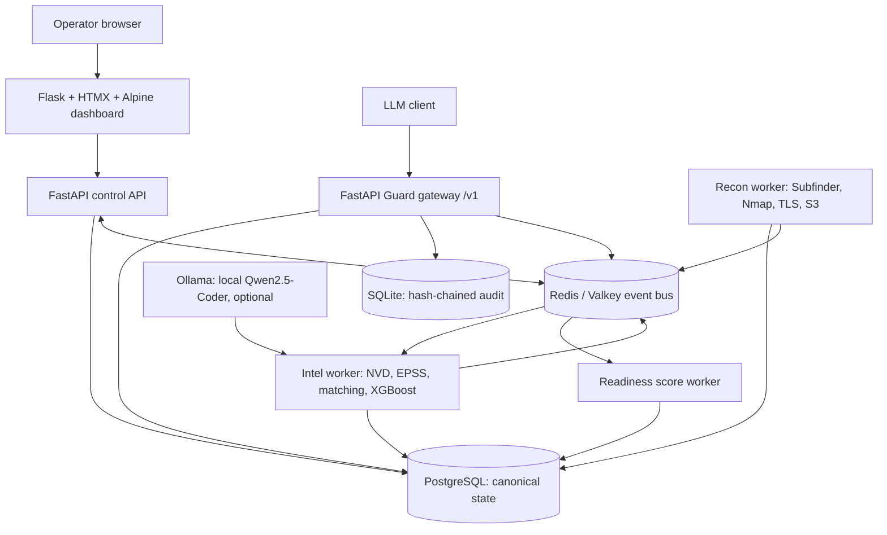
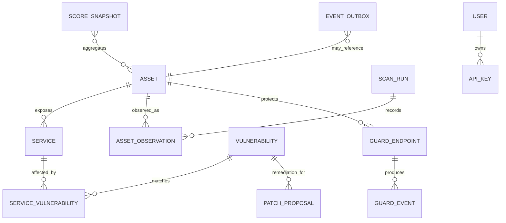

# ZeroTrace architecture

[← Wiki index](index.md) · Related: [Recon](trace-recon.md) · [Intel](trace-intel.md) · [Guard](trace-guard.md) · [Readiness](operational-readiness.md)

## Topology

The source describes three modules sharing PostgreSQL and Redis Pub/Sub. This design makes the API/UI, scanner workers, and Guard independently restartable while keeping a single laptop Compose project. PostgreSQL is authoritative; Redis is a fast notification path, not the only copy of critical facts. Consumers should be idempotent and periodically reconcile from database state. For reliable processing, use Redis Streams or a PostgreSQL outbox rather than assuming Pub/Sub is durable.

## Service boundaries

| Service | Responsibilities | Exposed ports |
|---|---|---|
| `dashboard` | Flask-Login session UI; calls control API | Host-facing HTTPS only |
| `api` | FastAPI REST, auth/RBAC, scans/patch queue/readiness | Host-facing HTTPS or dashboard internal only |
| `recon-worker` | Bounded scanner processes and normalized findings | None |
| `intel-worker` | Feed sync, CPE match, score, remediation proposal lifecycle | None |
| `guard` | OpenAI-compatible reverse proxy, detection, PII scan, API-key auth | Host-facing HTTPS if clients need it |
| `postgres` | Canonical relational state | Internal Compose network only |
| `valkey` | Cache, rate limiting, event notifications | Internal only |
| `ollama` | Optional local model inference; only accessed by Intel | Internal only |

The PDF proposes FastAPI plus Flask dashboard. Keep Flask limited to HTML/session UI and FastAPI as the API/proxy boundary to avoid duplicated business logic. Run schema migrations once as a one-shot Compose job; workers must wait for healthy dependencies and handle reconnects.

## Relational model (logical ERD)

### Core entities

- **Asset:** stable identity (normalized hostname/IP/cloud resource), first/last seen, owner/environment tags, source, authorization scope, status. Unique key should be tenant/scope + canonical identifier, not merely raw string.
- **Service:** asset FK, protocol, port, product/version/banner, CPE (nullable), exposure status, last checked.
- **AssetObservation / ScanRun:** timestamped scanner provenance, raw-result reference, status and error; retain scan history to distinguish newly found, stale, and Shadow IT assets.
- **Vulnerability:** CVE identifier, NVD facts/CVSS, EPSS value/date, KEV status, model version/probability and source timestamps.
- **ServiceVulnerability:** service FK + vulnerability FK, match confidence/method, evidence, review status. Avoid claiming a match from product-name similarity alone.
- **PatchProposal:** target, generated content/hash, model/prompt version, validation results, approval/execution state, reviewer, rollback note. Default state is `proposed`, never auto-applied.
- **GuardEndpoint / GuardEvent:** endpoint mapping and per-request metadata: outcome, scores, policy/model versions, latency, endpoint and linked asset/vulnerability IDs where known. Do not store plaintext prompt/response by default.
- **ScoreSnapshot:** component indexes, weights, final score, computation time and formula version for reproducibility.
- **EventOutbox:** transactional events written with the state change then published/retried; consumers store processed event IDs for idempotence.
- **User / APIKey:** role, salted password hash or key hash, rotation/expiry, audit metadata. Never persist raw API keys.

## Event flows

| Event | Producer → consumer | Expected action |
|---|---|---|
| `asset_created` | Recon → Intel / score engine | Correlate services to CVEs, update exposure index, recompute score |
| `vuln_matched` | Intel → Guard / score engine | Attach CVE context to matching Guard endpoint and elevate event priority |
| `attack_blocked` | Guard → score engine | Update AI exposure and recompute score |
| `vuln_patched` | Intel → Recon / score engine | Schedule a verification rescan, update status and recalculate |

Persist source state before publishing. Include event ID, schema version, entity ID, timestamp, correlation ID and bounded payload; publish identifiers rather than secrets or raw prompts. Use retries with backoff and a dead-letter table/stream. Rebuild derived scores from canonical records.

## Resource fit and profiles

The PDF claims roughly 9 GB active footprint, minimum 16 GB RAM, and separately lists Windows (~4 GB), WSL2 (~2 GB), Postgres (~0.5 GB), Valkey (~0.3 GB), FastAPI (~0.6 GB), Ollama Q4 7B (~4.5 GB), ONNX (~0.4 GB), and Flask (~0.2 GB). These line items do not establish a reproducible 9 GB peak including host OS, Docker overhead, scanner concurrency, and model loading. The design goal supplied by the user is **about 9 GB on a 16 GB laptop**; treat it as a performance acceptance criterion.

Use resource limits and concurrency controls. Offer profiles: `core` (no Ollama; regex + quantized/light CPU classifier), `full` (all models, low scanner concurrency), and `dev`. Measure cold start and peak RSS under concurrent Recon + Guard + model inference, leaving at least 2–3 GB host headroom. Set model context and worker counts explicitly. If Qwen2.5-Coder 7B does not fit, make auto-fix an opt-in resource-heavy capability rather than breaking the core platform.

## Deployment and security boundaries

- Compose networks: internal data network and ingress network. Do not publish PostgreSQL or Valkey ports to the host by default.
- Mount secrets through env files/secrets; `.env` is untracked and permission-restricted. Use bcrypt password hashes, short-lived JWTs, roles, CSRF defense, and API key hashes.
- Use TLS at the ingress boundary; set security headers. The source lists self-signed TLS and strict security headers for local use.
- Persistent named volumes for PostgreSQL and audit data; scheduled `pg_dump` backups and tested restore. SQLite audit chain is tamper-evident, not immune to privileged deletion; copy checkpoints off the writable container volume when stronger evidence preservation is required.
- Restrict scanners to configured domains/CIDRs and explicit authorization. Avoid privileged Nmap modes unless specifically needed; document capabilities and scan types.

## Open decisions

1. Choose Redis Pub/Sub simplicity versus Streams/Postgres outbox reliability.
2. Define tenant/scope identity and asset ownership model before schema migration v1.
3. Set exact Guard fail-open policy (source says Redis limiter outage fails open; consider fail-closed or bounded local limiter for protected production endpoints).
4. Define the 9 GB measurement method and minimum supported profile.
5. Clarify whether host API docs are enabled outside development.
