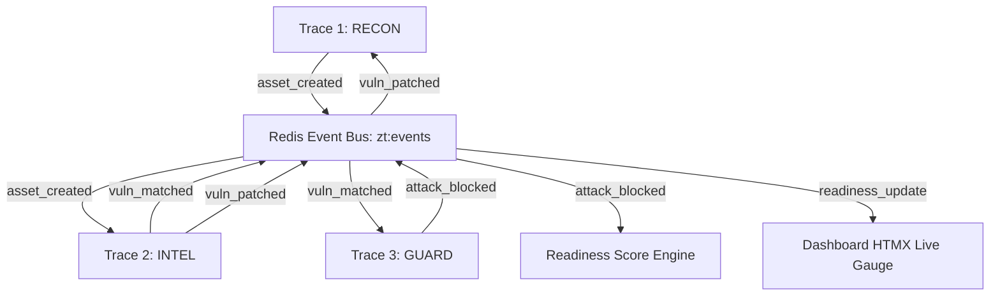
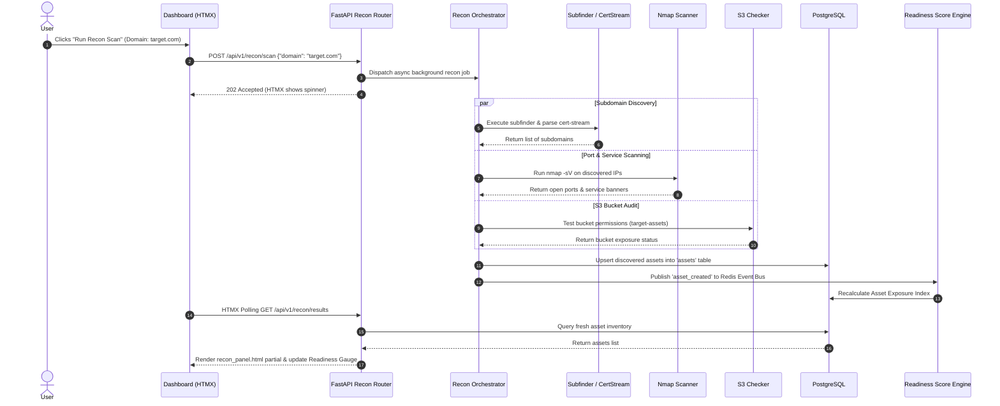
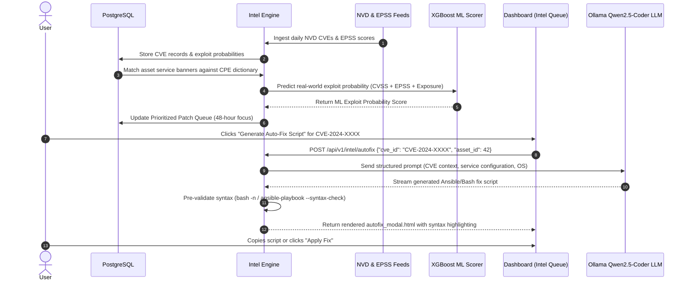
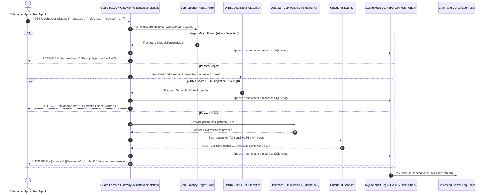

# ZEROTRACE: UNIFIED SYSTEM ARCHITECTURE & FILE HIERARCHY (v2.0)

**Document Title**: ZeroTrace System Blueprint, File Hierarchy & Click-to-Output Flow Architecture (v2.0)  
**Author**: Aniruddh Gupta  
**Project**: ZeroTrace — A Three-Module Unified Cyber Defense Platform  
**Target Hardware**: Single Laptop (CPU-only, ≥16GB RAM, No GPU required)  
**Core Stack (2026)**: Python 3.12, FastAPI, PostgreSQL 16, Redis/Valkey 7, SQLite 3, Flask + HTMX + Alpine.js, XGBoost, ONNX Runtime (DistilBERT), Ollama (Qwen2.5-Coder 7B Q4_K_M), Docker Compose.

---

## 1. Executive Summary & Philosophy

**ZeroTrace** operates on the core principle: *"They leave no trace. Because we found them first."*
It is an open-source, zero-cost, CPU-optimized cybersecurity platform combining three modular traces into a single source of truth:

1. **Trace 1 (RECON)**: Attack Surface Discovery (Subdomain enumeration, Port & service discovery, S3 bucket misconfiguration, SSL expiry monitoring, Shadow IT flagging).
2. **Trace 2 (INTEL)**: AI-Powered Vulnerability Prioritization (NVD + EPSS feed ingestion, XGBoost exploit probability model, CPE matching, Ollama auto-fix script generation).
3. **Trace 3 (GUARD)**: LLM Security Middleware Gateway (Zero-latency Regex filters, ONNX DistilBERT semantic prompt injection classifier, Output PII scanner, Hash-chained SQLite audit logging).
4. **UNIFIED CORE (Fixed Formula v2.0)**:
   $$\text{Operational Readiness Score} = 100 - (0.40 \times \text{Asset Exposure Index} + 0.40 \times \text{Vulnerability Urgency Index} + 0.20 \times \text{AI Threat Exposure Index})$$

---

## 2. Complete File Hierarchy v2.0

```text
zerotrace/
├── docker-compose.yml              # Multi-container orchestration (DB, Redis, API, Dashboard, Ollama)
├── Dockerfile.api                  # Docker build file for FastAPI backend engine
├── Dockerfile.dashboard            # Docker build file for Flask/HTMX dashboard
├── .env.example                    # Environment variable templates (DB credentials, API keys, JWT secrets)
├── .gitignore                      # Exclude bytecode, ONNX weights, local SQLite DB, logs, .env
├── Makefile                        # Dev commands (make run, make test, make db-migrate, make clean)
├── requirements.txt                # Python dependencies (FastAPI, Flask, SQLAlchemy, XGBoost, ONNX, python-jose, etc.)
├── README.md                       # Comprehensive project setup and execution manual
│
├── config/                         # Configuration Management System
│   ├── __init__.py
│   ├── settings.py                 # Pydantic BaseSettings loading .env config
│   ├── logging_config.py           # Structured JSON logging configuration
│   └── database.py                 # SQLAlchemy async engine, session maker, Redis client init
│
├── db/                             # Relational Data Layer (PostgreSQL & Alembic)
│   ├── alembic.ini                 # Database migration configuration
│   ├── migrations/                 # Alembic migration scripts directory
│   │   ├── env.py
│   │   └── versions/
│   │       └── 0001_initial_schema.py
│   └── models/                     # SQLAlchemy ORM Data Models
│       ├── __init__.py
│       ├── asset.py                # Asset table (IP, Hostname, Ports, Services, S3, SSL, Shadow IT flag)
│       ├── vulnerability.py        # CVE, CVSS, EPSS score, ML Exploit Score, Patch Status
│       ├── llm_audit.py            # Guard proxy request records (Prompt hash, score, blocked flag, chain hash)
│       ├── readiness.py            # Historical Operational Readiness Score snapshots
│       └── user.py                 # User authentication model (Username, bcrypt password hash, RBAC role) [NEW v2.0]
│
├── auth/                           # Authentication & Authorization Subsystem [NEW v2.0]
│   ├── __init__.py
│   ├── jwt_handler.py              # JWT token creation, decoding, validation, and refresh logic
│   ├── session_manager.py          # Flask-Login session authentication manager
│   ├── rbac.py                     # Role-Based Access Control decorator (Viewer, Operator, Admin)
│   └── password_utils.py           # Bcrypt hashing & verification utilities
│
├── modules/                        # Core Domain Logic (Three Traces)
│   ├── __init__.py
│   │
│   ├── recon/                      # TRACE 1: RECON MODULE (Attack Surface Discovery)
│   │   ├── __init__.py
│   │   ├── subdomains.py           # Subdomain enumeration engine (subfinder + cert-stream listener)
│   │   ├── port_scanner.py         # Nmap top-100 port & service banner discovery wrapper
│   │   ├── s3_checker.py           # AWS S3 public bucket misconfiguration tester
│   │   ├── ssl_monitor.py          # SSL/TLS certificate expiration & protocol checker
│   │   ├── shadow_it.py            # Inventory lookup & unauthorized asset flagger
│   │   └── runner.py               # Orchestrator running full recon workflow async with timeout recovery
│   │
│   ├── intel/                      # TRACE 2: INTEL MODULE (Vulnerability Prioritization)
│   │   ├── __init__.py
│   │   ├── nvd_feed.py             # NVD API ingestor for CVE vulnerability data (with rate-limit fallback)
│   │   ├── epss_feed.py            # EPSS (Exploit Prediction Scoring System) daily CSV parser
│   │   ├── cpe_matcher.py          # Service banner to CPE 2.3 string & CVE mapper
│   │   ├── ml_scorer.py            # XGBoost ML inference engine for exploit probability scoring
│   │   ├── patch_queue.py          # 48-hour prioritized remediation queue generator
│   │   └── autofix_llm.py          # Local Ollama Qwen2.5-Coder prompt builder & code generator (syntax checked)
│   │
│   └── guard/                      # TRACE 3: GUARD MODULE (LLM Security Middleware)
│       ├── __init__.py
│       ├── proxy.py                # FastAPI reverse proxy endpoint intercepting /v1/chat/completions
│       ├── regex_filter.py         # Fast zero-latency heuristic & regex rule checker
│       ├── injection_classifier.py  # ONNX Runtime DistilBERT semantic prompt injection detector (<10ms)
│       ├── pii_scanner.py          # Outbound response scanner for API keys, SSNs, and credit cards
│       ├── sqlite_logger.py        # Append-only SHA-256 hash-chained tamper-resistant audit logger
│       └── rate_limiter.py         # Redis token-bucket rate limiter per client ID
│
├── core/                           # Unified System Core Engine
│   ├── __init__.py
│   ├── readiness_calculator.py     # Directionally-consistent Operational Readiness Score engine
│   ├── event_bus.py                # Redis Pub/Sub async event dispatcher (zt:events) [NEW v2.0]
│   └── redis_cache.py              # High-frequency query caching helper
│
├── api/                            # Backend API Service (FastAPI)
│   ├── __init__.py
│   ├── main.py                     # FastAPI entrypoint, CORS, security headers, JWT middleware
│   ├── routers/
│   │   ├── recon_router.py         # Endpoints for triggering & querying Recon scans
│   │   ├── intel_router.py         # Endpoints for CVE query, patch queue, auto-fix generation
│   │   ├── guard_router.py         # Interception proxy + Guard log query endpoints
│   │   ├── readiness_router.py     # Operational Readiness Score & metrics API
│   │   └── auth_router.py          # Login, logout, JWT refresh, user management endpoints [NEW v2.0]
│   └── schemas/                    # Pydantic Request/Response Models
│       ├── recon_schema.py
│       ├── intel_schema.py
│       ├── guard_schema.py
│       ├── readiness_schema.py
│       └── auth_schema.py          # LoginRequest, TokenResponse, UserCreate schemas [NEW v2.0]
│
├── dashboard/                      # Front-end UI (Flask + HTMX + Alpine.js)
│   ├── app.py                      # Flask app handling session auth & rendering HTMX partials
│   ├── static/
│   │   ├── css/main.css            # Dark-mode cybersecurity UI styling (glassmorphism & cyber glow)
│   │   ├── js/app.js              # Alpine.js state store & HTMX event handlers
│   │   └── vendor/                 # Offline vendor packages (No Node.js / npm needed)
│   │       ├── htmx.min.js         # HTMX 1.9.x (14KB)
│   │       └── alpine.min.js       # Alpine.js 3.x (15KB)
│   └── templates/
│       ├── base.html               # Main HTML layout, head, scripts, navbar
│       ├── login.html              # CSRF-protected login page [NEW v2.0]
│       ├── index.html              # Command Center Unified View
│       └── components/
│           ├── readiness_gauge.html # Animated SVG score ring (HTMX auto-refresh via event bus)
│           ├── recon_panel.html    # Discovered assets & open ports table
│           ├── intel_panel.html    # Prioritized patch queue & auto-fix modal trigger
│           ├── guard_panel.html    # Real-time LLM attack logs & block counters
│           └── autofix_modal.html  # Syntax-validated script display
│
├── models_weights/                 # Model Artifacts (Downloaded at setup, NOT in Git)
│   ├── distilbert_injection.onnx   # Quantized DistilBERT model (~65MB)
│   ├── tokenizer_config.json       # HuggingFace tokenizer configs for DistilBERT
│   └── xgboost_exploit_model.pkl   # Pre-trained XGBoost exploit classifier weights
│
├── scripts/                        # Utility & Setup Automation Scripts
│   ├── download_models.py          # Script to fetch ONNX model & tokenizer files
│   ├── seed_database.py            # Populates DB with initial sample asset & threat data
│   ├── create_admin.py             # Script to create initial admin user [NEW v2.0]
│   └── start_services.sh           # Docker entrypoint starter script
│
└── tests/                          # Automated Test Suite (pytest)
    ├── conftest.py                 # Test fixtures & database mock setup
    ├── test_recon.py               # Unit tests for subdomain, nmap, S3, SSL scanners
    ├── test_intel.py               # Unit tests for CPE matching, XGBoost scoring, Ollama prompt
    ├── test_guard.py               # Unit tests for Regex filter, ONNX classifier, PII scanner
    ├── test_readiness.py           # Unit tests for Readiness score formula & monotonicity
    ├── test_auth.py                # Tests for JWT creation, password hashing, RBAC [NEW v2.0]
    └── test_integration.py         # End-to-end integration tests [NEW v2.0]
```

---

## 3. Database Entity-Relationship Diagram (v2.0)

```text
┌─────────────────┐         ┌──────────────────────┐         ┌────────────────────┐
│     assets      │         │   vulnerabilities    │         │     llm_audit      │
├─────────────────┤         ├──────────────────────┤         ├────────────────────┤
│ id (PK)         │──┐      │ id (PK)              │──┐      │ id (PK)            │
│ ip_address      │  │      │ cve_id               │  │      │ timestamp          │
│ hostname        │  │      │ cve_description      │  │      │ prompt_hash        │
│ subdomain       │  │      │ cvss_score           │  │      │ regex_flagged      │
│ open_ports      │  │      │ epss_score           │  │      │ onnx_score         │
│ services        │  │      │ ml_exploit_prob      │  │      │ blocked            │
│ cpe_string      │  │      │ patch_status         │  │      │ pii_detected       │
│ s3_exposed      │  │      │ auto_fix_script      │  │      │ asset_id (FK) ─────┤
│ ssl_expiry      │  │      │ asset_id (FK) ───────┘  │      │ response_hash      │
│ shadow_it_flag  │  │      │ created_at           │  │      │ chain_hash         │
│ discovered_at   │  │      │ updated_at           │  │      │ created_at         │
│ updated_at      │  │      └──────────────────────┘  │      └────────────────────┘
└─────────────────┘  │                                │
                     │      ┌──────────────────────┐  │
                     │      │  readiness_history   │  │
                     │      ├──────────────────────┤  │
                     └─────►│ id (PK)              │  │
                            │ score                │  │
                            │ asset_exposure       │  │
                            │ vuln_urgency         │  │
                            │ ai_threat_exposure   │  │
                            │ calculated_at        │  │
                            └──────────────────────┘  │
                                                      │
┌────────────────────┐                                │
│       users        │      ┌──────────────────────┐  │
├────────────────────┤      │    guard_api_keys    │  │
│ id (PK)            │      ├──────────────────────┤  │
│ username           │      │ id (PK)              │  │
│ password_hash      │      │ key_hash             │  │
│ role               │      │ client_name          │  │
│ created_at         │      │ created_by (FK) ─────┼──┘
│ last_login         │      │ is_active            │
│ is_active          │      │ created_at           │
└────────────────────┘      └──────────────────────┘
```

---

## 4. Cross-Module Event Bus Architecture (NEW v2.0)



---

## 5. End-to-End Click-to-Output Flow Architecture Diagrams

### 5.1 Trace 1: RECON Scan Execution Flow


---

### 5.2 Trace 2: INTEL Vulnerability & Syntax-Validated Auto-Fix Script Flow


---

### 5.3 Trace 3: GUARD LLM Gateway Interception & Hash-Chained Audit Log Flow


---

## 6. Self-Defense & Platform Security Architecture (v2.0)

| Layer | Security Mechanism | Implementation |
| :--- | :--- | :--- |
| **Dashboard** | Session Authentication | Flask-Login with `@login_required` decorator & CSRF tokens |
| **API Backend** | JWT Bearer Tokens | FastAPI `Depends(get_current_user)` with 1-hour expiry |
| **Guard Proxy** | API Key Authentication | `X-API-Key` header validated against `guard_api_keys` table |
| **Database** | Docker Network Isolation | PostgreSQL & Redis bind to internal bridge network (`172.x.x.x`) with **no host exposed ports** |
| **Audit Logs** | Cryptographic Hash Chain | SQLite row $N$ hash = $\text{SHA256}(\text{Row } N-1 \text{ hash} + \text{Row } N \text{ data})$ |
| **HTTP Headers** | Hardened Security Headers | `X-Content-Type-Options: nosniff`, `X-Frame-Options: DENY`, `CSP`, `HSTS` |

---

## 7. Operational Readiness Score (v2.0 Directionally Consistent Formula)

$$\text{Score} = 100 - \left(0.40 \times \text{Asset Exposure Index} + 0.40 \times \text{Vulnerability Urgency Index} + 0.20 \times \text{AI Threat Exposure Index}\right)$$

Where:
- **Asset Exposure Index** = $(\text{exposed services} / \text{total services}) \times 100$
- **Vulnerability Urgency Index** = $\sum (\text{ML Exploit Probability} \times \text{CVSS Severity}) / \text{total assets} \times 100$
- **AI Threat Exposure Index** = $(\text{unblocked attack attempts} / \text{total LLM requests}) \times 100$

### Score Interpretation Table
| Score Range | Status | Meaning | Required Action |
| :--- | :--- | :--- | :--- |
| **90 – 100** | 🟢 Secure | Minimal exposure, no critical vulns, no unblocked AI attacks | Maintain current posture |
| **70 – 89** | 🟡 Moderate | Low-priority exposure or non-exploited CVEs present | Review patch queue & check exposed ports |
| **50 – 69** | 🟠 Elevated | Critical vulns present or unblocked AI attack detected | Immediate remediation required |
| **0 – 49** | 🔴 Critical | Multiple critical vulns + exposed assets + active AI attacks | Emergency response — isolate and patch |
