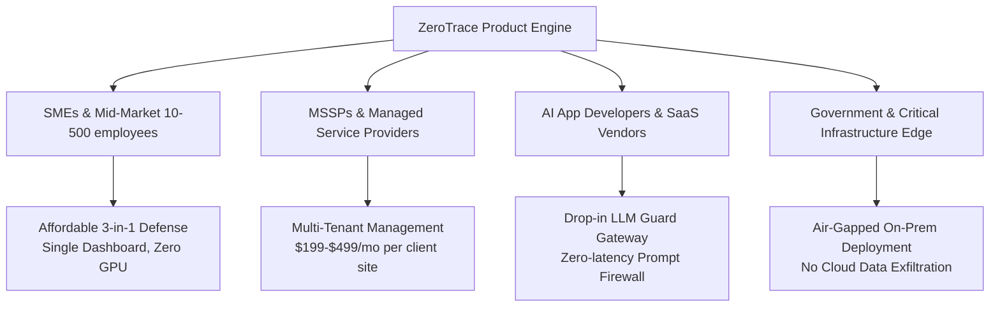
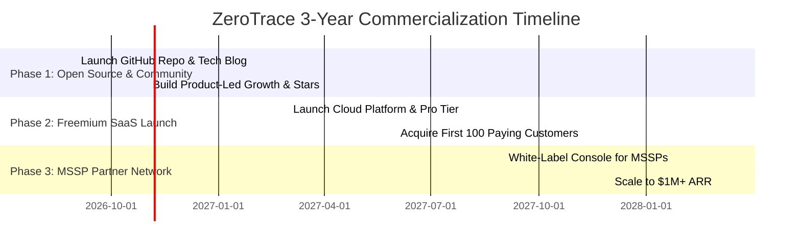

# ZEROTRACE: COMMERCIALIZATION & GO-TO-MARKET (GTM) STRATEGY

**Project**: ZeroTrace — A Three-Module Unified Cyber Defense Platform  
**Author**: Aniruddh Gupta  
**Target Market**: Small-to-Medium Enterprises (SMEs 1-250 employees), Managed Security Service Providers (MSSPs), DevSecOps Teams, and Mid-Market Enterprises.

---

## 1. Executive Summary: Is ZeroTrace Commercializable?

**Yes, absolutely.** ZeroTrace sits at the intersection of three high-growth cybersecurity sectors:
1. **Attack Surface Management (ASM)** — Expected market size: **$8.2B by 2030**.
2. **Vulnerability Prioritization & Remediation (VPR)** — Expected market size: **$14.1B by 2030**.
3. **AI / LLM Application Security Gateways** — Emerging high-urgency market driven by AI adoption.

Enterprise security tools (e.g., Palo Alto Cortex Xpanse, Qualys, Tenable, Lakera, Robust Intelligence) cost **$50,000 to $250,000+ per year**. This leaves over **95% of SMEs without unified threat visibility**. ZeroTrace solves this exact problem by delivering an enterprise-grade 3-in-1 cyber defense engine designed to run on modest, CPU-only hardware.

---

## 2. Target Market Segments & Buyer Personas

### Key Buyer Profiles:
- **CISO / IT Director at SMEs**: Frustrated by paying for 3 separate tools (ASM + Scanner + AI Guard) with disconnected dashboards. Wants **one Operational Readiness Score**.
- **MSSP / Security Consultant**: Looking for a high-margin tool to offer continuous threat vulnerability management to 50+ business clients.
- **Lead AI / Software Architect**: Building GenAI chatbots/agents and needing a zero-latency firewall to block prompt injections without paying 6-figure SaaS fees.

---

## 3. Recommended Commercial Business Models

### Option A: Open-Core / Freemium SaaS (Highest Scalability)
- **Community Edition (Open Source - Free)**:
  - Core Recon (subdomain & port scanner).
  - Basic NVD matching & CVSS scoring.
  - Basic Guard proxy with regex filters.
- **Enterprise Edition (Paid Subscription - $299 to $999/month)**:
  - XGBoost ML Exploit Scorer & EPSS real-time synchronization.
  - ONNX DistilBERT prompt injection model.
  - Automated Ansible/Terraform patch execution engine.
  - Role-Based Access Control (RBAC), SSO/SAML, SIEM export (Splunk, Elastic).

### Option B: MSSP Multi-Tenant Partner Program (Fastest Revenue)
- License ZeroTrace to Managed Security Service Providers for **$99/month per monitored organization**.
- MSSPs rebrand the dashboard (White-Labeling) and charge their clients **$300 – $600/month** for managed cyber resilience.

### Option C: Plug-and-Play Edge Appliance ("SOC-in-a-Box")
- Ship a pre-configured Mini PC (e.g. Intel NUC or ARM Edge device) running the ZeroTrace Docker stack.
- Sold as a hardware + software subscription bundle (**$1,499 upfront + $199/month maintenance**). Ideal for air-gapped industrial, healthcare, or financial environments.

### Option D: Guard API Gateway Usage Pricing
- Offer **Guard** as a standalone cloud security proxy for AI app developers.
- Charge **$0.001 per 1,000 LLM requests** for prompt injection & PII filtering.

---

## 4. Key Competitive Advantages (The "ZeroTrace Moat")

| Feature | Legacy Enterprise Tools (Qualys/Tenable) | Single-Point AI Firewalls (Lakera) | **ZeroTrace Unified v2.0** |
| :--- | :--- | :--- | :--- |
| **Price** | $50,000 – $250,000/yr | $20,000 – $80,000/yr | **$0 Open-Source / $2,999/yr SaaS** |
| **Scope** | Infrastructure CVEs only | LLM prompts only | **Unified 3-in-1 (Infrastructure + CVE + LLM)** |
| **Vulnerability Prioritization** | Static CVSS (99% noise) | N/A | **XGBoost ML + EPSS (48-hr priority queue)** |
| **Unified Metric** | Multiple complex reports | Attack logs only | **Single Operational Readiness Score (0-100)** |
| **Hardware Fit** | Heavy cloud / server requirements | Cloud API dependency | **CPU-Only, 9GB RAM, Runs on single laptop** |
| **Remediation** | Manual patching required | None | **Automated Ollama AI Script Generator** |

---

## 5. 3-Year Monetization Roadmap

---

## 6. Conclusion & Recommendation

ZeroTrace has **immense commercial viability**. 

### Why Investors & Enterprise Customers Will Love It:
1. **Timing**: Cyber threats and AI security risks are exploding simultaneously in 2026.
2. **Cost-to-Performance Ratio**: Operates on CPU-only hardware using quantised AI models, drastically lowering hosting costs for SaaS providers.
3. **Emergent Value**: Combining RECON + INTEL + GUARD produces actionable insights that no isolated tool can replicate.

**Recommended Next Step**: Complete the open-source MVP core code, publish a benchmark demo video, and apply to cybersecurity incubators / accelerators (e.g. Y Combinator, Techstars, CyLon) or launch a product-led SaaS platform.
