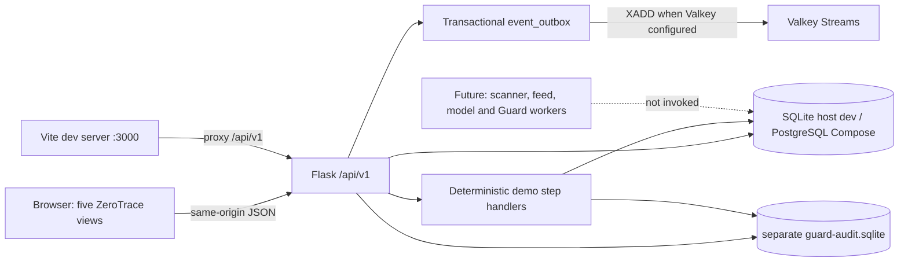

# ZeroTrace page and engine connectivity map

**Status:** the dashboard, Flask API, SQL persistence, event outbox and Guard audit file are connected. Recon/Intel/Guard outcomes remain deterministic synthetic fixtures; no external tools, feeds, models or upstream calls are executed.

Related: [Backend connectivity and API contract](02-backend-connectivity.md), [compiled architecture](../../zerotrace/wiki/architecture.md), [Recon](../../zerotrace/wiki/trace-recon.md), [Intel](../../zerotrace/wiki/trace-intel.md), [Guard](../../zerotrace/wiki/trace-guard.md), [readiness score](../../zerotrace/wiki/operational-readiness.md).

## 1. Connected architecture

Development uses Vite on port 3000 and Flask on `127.0.0.1:5000`; Vite proxies relative `/api/v1` paths. Docker Compose builds the same frontend, Flask serves both UI and API on port 3000, PostgreSQL is the canonical database target, and Valkey publishes outbox notifications. PostgreSQL/Valkey are not published to the host by default. Host development uses SQLite to keep startup simple. Guard's integrity trail is always a separate SQLite file.

## 2. Page-to-service ownership

| Page | Backend reads used by the UI | Writes/actions | Shared effect |
|---|---|---|---|
| **Architecture** (`/`) | `GET /demo/state` | One-step sequence via `POST /demo/steps/{recon|intel|guard}` | Shows active database, Valkey connection/pending state, audit integrity and latest readiness. |
| **Database & Events** (`/database`) | `GET /events`, `GET /readiness/history`, plus shared state | No direct database writes | Displays real outbox rows/status, formula-versioned snapshots and separate audit summary. |
| **Trace Recon** (`/recon`) | `GET /assets`, `GET /recon/scans` | `POST /demo/steps/recon` | Persists the sample scan with an S3-unknown partial warning, asset and `asset_created` event. |
| **Trace Intel** (`/intel`) | `GET /intel/status`, `GET /matches`, `GET /patch-proposals` | `POST /demo/steps/intel` | Persists the synthetic match, a review-required 48-hour proposal, `vuln_matched` and a readiness snapshot. |
| **Trace Guard** (`/guard`) | `GET /guard/status`, `GET /guard/events`, `GET /guard/audit/verify` | `POST /demo/steps/guard` | Stores only a blocked-decision record in SQL and appends correlated metadata to the separate SQLite hash chain. |

The central React context reads `GET /api/v1/demo/state` on load and after each action. Page-specific resources then read their own APIs. All changes are authoritative in the backend response; the UI does not claim success before the API confirms the persisted stage.

## 3. Shared records and identifiers

The backend prototype stores `demo_scenario`, `scan_runs`, `assets`, `vulnerabilities`, `service_vulnerabilities`, `patch_proposals`, `guard_events`, `score_snapshots`, and `event_outbox`. The asset's two service fixture records are currently JSON on the `assets.services` field; a normalized `services` table is future schema work. No accounts, scopes, API keys, or scanner output are persisted.

The sample flow uses these stable identifiers:

- Asset: `asset_zt_001` (`portal.zt-lab.test`, `.test` is reserved for examples).
- Finding: `finding_zt_001` / `ZT-DEMO-0001` (fictional; not a real CVE).
- Correlation: `corr_demo_7a20`.
- Events: `EVT-DEMO-1042` asset, `EVT-DEMO-1043` Recon snapshot, `EVT-DEMO-1044` finding match, `EVT-DEMO-1045` Intel snapshot, `EVT-DEMO-1046` blocked Guard request, and `EVT-DEMO-1047` Guard snapshot.

The Guard audit entry links the same event, asset, finding and correlation IDs. It intentionally excludes the displayed UI prompt text and credentials.

## 4. Event and state transitions

1. Recon action adds a `scan_runs` row with `completed_with_warnings`, `partial=true`, and an explicit S3-not-queried warning; it inserts the fictional asset and an `asset_created` outbox event in the same SQL transaction.
2. A score snapshot is saved with the Recon event. The readiness values are nullable: components with no denominator remain unknown rather than zero.
3. Intel action creates a synthetic vulnerability, a service-vulnerability association with review evidence, and a proposal row with `review_required=true`, `execution_allowed=false`, and a 48-hour review window. It writes `vuln_matched` plus a snapshot.
4. Guard action writes a minimal `attack_blocked` SQL row and appends to `guard-audit.sqlite` using `previous_hash | canonical_record → SHA-256`. The outbox event and final score snapshot are committed with the stage change.
5. After each committed action, the API attempts to publish pending outbox rows to a Valkey/Redis Stream. Without a configured/reachable bus, rows remain pending and are visible in Database & Events. There are no Redis consumer workers yet.

Delivery is designed as at-least-once. An event ID is stable and consumers must be idempotent. The SQLite chain is tamper-evident, not tamper-proof; verification cannot prevent a privileged user from deleting the whole file.

## 5. Not implemented

No scanner subprocess, real scan job/cancellation, feed sync, XGBoost model, Ollama call, ONNX/DistilBERT classifier, LLM API-key validation, live reverse proxy, model response/PII scan, auth/RBAC, event consumer, patch execution, or production migration/backup flow is present. These are explicit next-stage work, not hidden behavior in the current connected demo.
